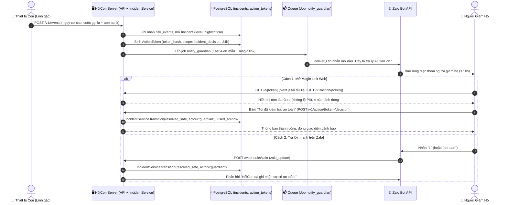

# Kế hoạch Hiện thực Kỹ thuật: Spec 023 — Cảnh báo người giám hộ & Trang hành động

**Mã ROADMAP**: `P2-07` · **Làn sở hữu**: Làn B (Server + Web) · **Cột mốc**: **Gate M1**

---

## 1. Kiến trúc Tổng thể & Luồng Dữ liệu



---

## 2. Thiết kế Chi tiết Từng Thành phần

### 2.1. Quản lý Action Token (`ActionTokenService`)
* **Bảng CSDL**: Đã có sẵn từ migration `0005` & `0006`: `action_tokens (id, incident_id, member_id, token_hash, scope, expires_at, used_at, created_at)`.
* **Cơ chế Token**:
  - Raw token: `secrets.token_urlsafe(32)` (chuỗi ngẫu nhiên $\approx 43$ ký tự, entropy cao).
  - Băm SHA-256: `hashlib.sha256(raw_token.encode()).hexdigest()` lưu vào `token_hash`.
  - Không bao giờ lưu raw token vào DB hay log.
* **Xác thực & Sử dụng**:
  - `verify(raw_token)`: tính băm $\to$ query CSDL $\to$ kiểm tra tồn tại, `expires_at > now()`, `used_at is None`.
  - `consume(raw_token)`: thực hiện trong cùng giao dịch với `IncidentService.transition()`, cập nhật `used_at = now()`.

### 2.2. Kích hoạt Cảnh báo Giai đoạn 1 (Fast Alert)
* Khi sự cố được tạo mới đạt `level` $\ge$ `high` hoặc chuyển sang `awaiting_guardian`:
  - Tìm người giám hộ chính (rank 1) của gia đình sự cố.
  - Sinh `ActionToken`.
  - Mẫu tin nhắn (theo `hoicon.agents.texts`):
    ```
    Đây là trợ lý AI HỏiCon.[ [DIỄN TẬP]]
    CẢNH BÁO: Phát hiện dấu hiệu rủi ro cao trên thiết bị của người thân ({member_name}).
    Hành vi: {summary_text}
    Bấm vào liên kết để kiểm tra và xử lý khẩn cấp:
    {settings.web_base_url}/a/{raw_token}
    Hoặc trả lời nhanh tin nhắn này:
    1 - An toàn | 2 - Lừa đảo, dừng khẩn | 3 - Báo nhầm
    ```
  - Xếp job `notify_guardian` qua hàm `enqueue(sessions, "notify_guardian", payload, key=...)`.

### 2.3. Endpoints REST API
1. `GET /v1/action/{token}`:
   - Trả về thông tin sự cố tóm tắt, tên người thân, tên thiết bị, danh sách rủi ro đã che số điện thoại, trạng thái sự cố hiện tại.
2. `POST /v1/action/{token}/decision`:
   - Body: `{"decision": "safe" | "prevented" | "false_alarm" | "emergency_pause", "note": "..."}`
   - Chuyển trạng thái sự cố và đóng token nguyên tử.
3. `POST /v1/incidents/{id}/decision`:
   - Tương tự nhưng chứng thực bằng JWT của Member role `guardian`.

### 2.4. Giao diện Web Next.js (`apps/web/src/app/a/[token]/page.tsx`)
* Sử dụng hoàn toàn Design System tokens (`Tokens.kt` / `tokens.css`):
  - Theme màu tương phản cao WCAG AAA ($\ge 7:1$).
  - Nút bấm to bản touch target $\ge 4\text{rem}$ ($64\text{px}$).
  - Trạng thái loading, error, success rõ ràng, không giật lag.
  - Hỗ trợ gọi điện nhanh người thân qua thẻ `<a href="tel:...">`.

---

## 3. Kế hoạch Kiểm tra & Nghiệm thu Gate M1

1. **Bộ kiểm thử đơn vị & tích hợp Backend**:
   - `test_action_token_service.py`: sinh, băm, kiểm tra hết hạn, dùng lại token.
   - `test_guardian_alert_flow.py`: tạo sự cố rủi ro cao $\to$ sinh token $\to$ xếp job Zalo $\to$ gọi API decision $\to$ sự cố chuyển sang `resolved_*`.
2. **Kiểm tra Frontend Next.js**:
   - Component rendering, màu sắc đạt chuẩn AAA, xử lý lỗi token hết hạn / đã dùng.
3. **Kịch bản E2E Gate M1 (`scripts/e2e-m1.sh`)**:
   - Tự động hóa kiểm tra: Cuộc gọi lạ + Mở demobank $\to$ SafePause bung lên $\le 3\text{ s}$ $\to$ Sự kiện gửi lên Server $\to$ Tin nhắn Zalo mock $\le 10\text{ s}$ $\to$ Gọi API decision đóng sự cố $\to$ Quét sạch 0 PII thô trong DB và log.
